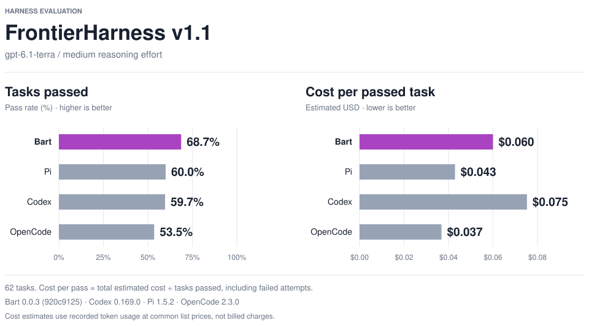

<h1 align="center">
  <picture>
    <source media="(prefers-color-scheme: dark)" srcset=".github/assets/logo-wordmark-dark.svg">
    
  </picture>
</h1>

<p align="center"><strong>Bart is an agent that likes notebooks!</strong></p>

A terminal coding harness built in Rust around a single persistent Python interpreter. Multi-step file reads, targeted edits, command runs and verification share one live Python session instead of burning extra model turns per tool call, with full **Ctrl+O** inspection of every step.

## Install

```sh
curl -fsSL https://github.com/MasterAwesome/bart-harness/releases/latest/download/install.sh | sh
bart login chatgpt
cd your-work-folder && bart
```

Linux (`x86_64`, `aarch64`) and macOS (Apple Silicon, Intel), requiring **Python 3.10+** and **Bash**. Installs to `~/.local/bin` ([inspect install.sh](.github/install.sh)); upgrade in place with `bart update`.

<details>
<summary>Build from source and optional Linux dependencies</summary>

- **From source (Rust 1.99+):**
  - From Git: `cargo install --locked --git https://github.com/MasterAwesome/bart-harness bart`
  - From a local checkout: `cargo install --locked --path bart-tui`
- **Clipboard images (`Ctrl+V` on Linux):** requires `wl-paste` or `xclip`
- **Containerless sandbox (`--jail` on Linux):** requires a systemd user session, `systemd-run` and `bubblewrap`

</details>

## Why Bart performs well

- **One persistent Python session instead of isolated tool calls.** Imports, parsed ASTs and JSON, helper functions and open handles persist across cells, letting one turn inspect, transform, edit and test without a separate model round-trip per action.
- **Data stays out of prompt context until needed.** Assigning `text = read(path)` or capturing command output in Python variables lets the agent filter, parse and slice in interpreter memory instead of bloating conversation history with full files or long logs.
- **Non-blocking background jobs with `bg_run`.** Servers, watchers and slow builds run asynchronously via `bg_run(..., notify=regex)` and wake the session on output matches or process exit instead of burning turns polling.
- **Lazy MCP discovery without schema bloat.** Configured MCP tools are queried inside Python via `mcp.tools(...)` rather than injecting every server schema into every request.
- **Step-level inspection and reversible turns.** Press **Ctrl+O** to inspect full Python code, stdout/stderr and diffs behind every cell, or use `/rewind` to roll conversation state back to an earlier message.

## Benchmarks

Across 62 tasks on [FrontierHarness v1.1](https://frontierharness.org) using the same `gpt-6.1-terra` model at medium reasoning effort, Bart passed **68.7%** of tasks at **$0.060** estimated cost per passed task—highest pass rate of the four harnesses tested (vs. **60.0%** Pi, **59.7%** Codex and **53.5%** OpenCode; estimated cost includes failed attempts at list token prices). OpenCode (**$0.037**) and Pi (**$0.043**) cost less per solved task at lower completion rates, while Bart beat Codex on both pass rate (**+9.0 pp**) and cost per passed task (**≈20% lower** than **$0.075**).

<picture>
  <source media="(prefers-color-scheme: dark)" srcset=".github/assets/benchmark-dark.svg">
  
</picture>

<sub>Tested across several Claude and other GPT models in interactive use but benchmarks are expensive, would love contributions here!</sub>

## Providers and auth

Use an existing **ChatGPT** or **Claude Code** subscription, an API provider, or a local model server:

```sh
bart login chatgpt            # ChatGPT subscription (--device for headless code login)
```

For Claude Code, install `claude` and run `claude auth login`; Bart discovers it automatically in `/model`.

For API and local endpoints, specify `<protocol>:<name>` and pipe the key on stdin (or pass `--no-key`):

```sh
bart login responses:openai   --url https://api.openai.com/v1 < key-file
bart login messages:anthropic --url https://api.anthropic.com/v1 < key-file
bart login gemini:gemini      --url https://generativelanguage.googleapis.com/v1beta < key-file
bart login chat:openrouter    --url https://openrouter.ai/api/v1 < key-file
bart login chat:local         --url http://localhost:8080/v1 --no-key
```

To use a password manager or another key helper instead of storing the API key in Bart, pass `--key-command` and put the program and its arguments after `--`:

```sh
bart login responses:openai --url https://api.openai.com/v1 --key-command -- op read op://Private/OpenAI/credential
bart login openai --key-command -- secret-tool lookup service openai
```

The first example adds a provider; the second switches an existing provider to a key command. At login Bart checks that the command prints one printable ASCII token, then saves the command, its arguments, and the provider URL, not the output. Bart will not use the command for a different URL. Do not put secrets in the arguments. Bart runs the command again when it first needs the key and retries once with a fresh key on HTTP 401 if the provider configuration and key command still match.

The command runs on the host with your environment, no stdin or terminal, and your home directory as its working directory (or `/` if unset). It has 30 seconds to finish. Bart passes arguments literally, without shell interpolation. Use a trusted executable and arguments; give scripts a shebang to select their interpreter, since Unix may run executable text files without one through a shell. Unlock your password manager first if it requires an interactive login. Bart kills the helper’s process group on timeout, cancellation, or oversized output, not after normal exit. A helper that leaves background processes with closed standard streams can leave them running.

Switch models with `/model`, adjust reasoning effort with `/effort` (**Alt+=** / **Alt+-** while typing), and list available `provider/model` pairs with `bart models`. Use `bart models <provider>` for model names and supported effort levels.

## CLI and scripting

```sh
bart -p "Summarize the errors in these logs and write summary.md"
bart --json
bart --resume
bart --approval manual --jail --no-network
```

- `-p, --prompt <TEXT>` runs headless for CI or scripts (`--keep-background-jobs` leaves spawned processes running after completion).
- `--json` streams a session over JSON lines (`messages` on stdin, `events` on stdout).
- `--resume` / `--session <ID>` continue saved local sessions; `--temporary` discards history on exit.
- Run `bart --help` for the full option list.

## Interactive controls and customization

| Key or command | Action |
| --- | --- |
| `Enter` | Send prompt, or steer an active turn |
| `Tab` | Queue a message for the next turn |
| `Esc` | Interrupt the current turn |
| `Ctrl+O` | Inspect full code, stdout/stderr and diffs per cell |
| `Alt+Enter` / `Ctrl+J` | Insert newline |
| `@` | Insert a workspace file path |
| `Ctrl+V` | Paste a clipboard screenshot |
| `/resume`, `/rewind` | Resume a session; undo conversation back to an earlier message (files untouched) |
| `/compact` | Compact context and continue |
| `/settings` | Configure approval mode, sandbox and preferences |

### MCP tools, `AGENTS.md` and skills

```sh
bart mcp add local -- <command> <args...>
bart mcp add remote --url https://example.com/mcp --bearer-token-env MCP_TOKEN
```

Bart calls configured MCP tools directly from Python cells; toggle or inspect servers with `/mcps`. Project conventions load from `AGENTS.md`, and reusable workflows in `~/.agents/skills/<name>/SKILL.md` trigger via `/<name>`.

## Execution control, privacy and license

- **Permissions and isolation:** Bart executes with your user permissions by default (`--approval none`). Pass `--approval manual` to review each cell, `--approval auto` for automated review, or `--jail` (`--no-network`) on Linux to isolate commands with `bubblewrap`.
- **Privacy:** **No telemetry.** Session records are saved locally; `/resume` restores history with a fresh Python interpreter. Prompts are sent only to your selected model provider.
- **Safety and license:** Built in Rust (`unsafe_code = "forbid"`), licensed under **MIT** or **Apache-2.0**.

## Feedback

Found a bug or have a proposal? [Open an issue](https://github.com/MasterAwesome/bart-harness/issues/new/choose), or report security issues via a [private advisory](https://github.com/MasterAwesome/bart-harness/security/advisories/new).
